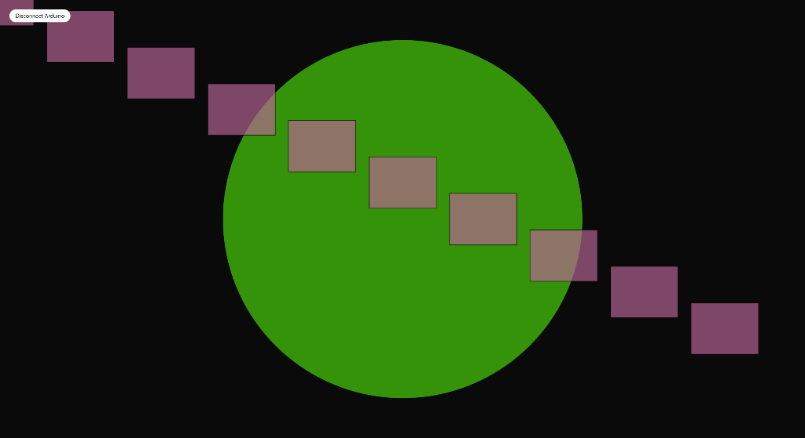

# Week 09 - Sensor Mapping

I connected an ultrasonic sensor to both an LED and a p5.js sketch. Distance changes the brightness, shape sizes and colours. I used smoothing in the sketch to make the visual response feel less abrupt.

| Activity | What I made |
| --- | --- |
| [9a - Mapping Sensors](Activity_9a/9a.ino) | Distance readings mapped to LED brightness. |
| [Sensor Jam](sensorjam/sensor-jam-template/index.html) | A circle and a row of rectangles that respond to distance through Web Serial. |

Upload 9a, close the Serial Monitor, then run Sensor Jam with a local server in Chrome or Edge. Click **Connect to Arduino** to begin.

