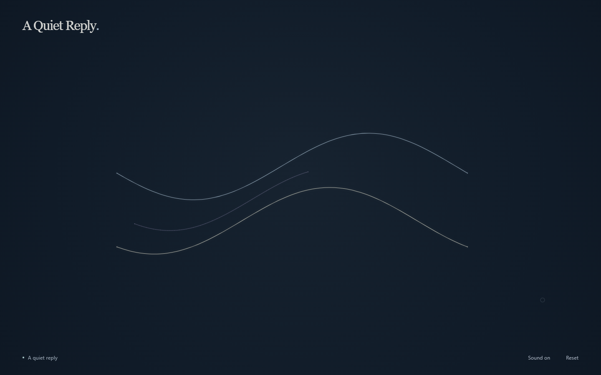

# A Quiet Reply

A small ambient instrument made with p5.js and Tone.js. Press anywhere, draw a line, and let it become a musical phrase. Higher gestures play higher notes; the lines linger, then disappear into the background.

**Phase 3: an exhibition-ready quiet conversation.** Draw a phrase, release, and leave a moment to listen. The instrument remembers your three most recent phrases and offers a slower, lighter variation. Warm, gently percussive user notes are answered by a more distant voice and a translucent lavender trace. Everything runs locally, using musical rules rather than machine learning. There is no continuous background texture: silence is part of the composition.



## Run locally

Install [Node.js](https://nodejs.org/) 20 or newer, then open a terminal in this folder:

```sh
npm install
npm run dev
```

Open **http://localhost:3000**. Stop the server with `Ctrl+C`. Edit a file and refresh the browser; there is no build step.

p5.js **1.11.3** and Tone.js **14.8.49** are pinned in `package.json` and `package-lock.json`. They are served from the local installation, so the instrument works without an internet connection after installation. Use the local server rather than opening `index.html` directly: JavaScript modules need HTTP.

If port 3000 is occupied, set `PORT` before starting. In PowerShell:

```powershell
$env:PORT = 3001
npm run dev
```

## Play

- **Press:** begin a phrase and play its first note. The first press also enables browser audio.
- **Drag:** draw a continuous line. Moving vertically selects a pitch; moving horizontally stays on the same pitch.
- **Release:** finish the phrase. Its sound rings out and its line slowly fades.
- **Listen:** after about two seconds, a softer voice answers with a delicate lavender line derived from your drawing.
- **Join or interrupt:** draw again at any time. Your instrument takes priority; the reply's remaining notes are cancelled and its tails fade down smoothly.
- **Sound on/off:** the small lower-right control fades all sound smoothly. Silent drawings are still remembered. Turning sound back on does not restart an old reply; draw again to begin a conversation.
- **Reset:** clear the drawings, musical memory, and reply queue, fade away old sound, and restore the invitation. The current sound on/off choice is preserved.
- Touch and pen use the same gestures. Only one drawing pointer is accepted at a time.
- Keyboard: Tab to the canvas, hold Space, move with the arrow keys, then release Space.

The eleven pitch regions are **C3, D3, E3, G3, A3, C4, D4, E4, G4, A4, C5**, from bottom to top. A small boundary buffer prevents jitter, and a 95 ms interval limits notes while dragging. If you cross a region during this interval and stop there, its note plays when the interval ends. Staying in one region does not repeat notes.

The user voice is a soft harmonic pluck: a 20 ms attack gives immediate feedback, followed by a gentle decay and 2.6-second release. A low-pass filter softens its upper harmonics, and a 3.6-second room at 28% wet leaves space around each note. Each note has a 0.45-second gate. Up to 32 user voices can overlap. At capacity, new notes are skipped; while a gesture remains active, its current pitch is retried when a voice becomes available. Existing tails continue uninterrupted. The first sound can play while the reverb prepares in the background.

## The conversation

The instrument uses four states:

| State | Behavior and next transition |
| --- | --- |
| `IDLE` | Quiet until a new gesture begins. |
| `USER_PLAYING` | Listen and record; no new automatic notes. Release enters `WAITING_TO_REPLY`. |
| `WAITING_TO_REPLY` | Leave two seconds after release before the first response. A new press returns to `USER_PLAYING`. |
| `SYSTEM_REPLYING` | Play one variation and progressively reveal its line. Completion waits for another, quieter variation, or returns to `IDLE`. |

With three playable memories, source-selection weights are **1:2:4**, oldest to newest. The generator samples an ordered subset, keeps the opening and ending when there is more than one note, occasionally exchanges an interior pair or moves a note one octave, and stretches timings by roughly 1.45–2.15 times. Very short intervals and very long pauses are bounded to make compact, unhurried responses. Pitches stay within C3–C5 and retain the source's pitch classes. A single tap receives a single, longer, softer answer.

After release, there are at most **three replies**: up to 10, 6, and 3 notes, with each later reply also limited to 70% of the previous note count (rounded down, minimum one). Their velocities decrease and their intervening silences grow to 8–10 and 16–18 seconds. Then the instrument becomes silent until you play again. A 90-second inactivity ceiling provides an additional bound.

The response uses a quieter sine synth with a 180 ms attack, 4.4-second release, darker filter, and a longer 5.8-second room at 50% wet. Its entire sound path, including the reverb tail, ducks over 180 ms when you start drawing. Existing envelopes finish naturally. It has a separate 12-voice limit, so a response cannot steal the user's voices. Both paths feed a −6 dB limiter and an 85% master gain, leaving generous output headroom. Sound on/off ramps this master over 200 ms.

Reset gently retires the two voice pools so a queued release for an old pitch cannot release a new note of the same pitch. It reuses the AudioContext, effects, canvas, and listeners. At most one retiring pair remains for 300 ms. The old reverb energy drains silently; new notes use the dry path immediately after the brief reset fade, and the room returns over the following eight seconds.

There is one pending reply queue, checked by the existing animation loop. Notes are scheduled just ahead on Tone's audio clock; the same clock controls the line's growing tip. Musical pauses also pause the line. No repeating transport loop or collection of delayed callbacks is created. A new press discards the queue. Blur, a hidden page, suspended audio, or a long stalled frame also cancels the conversation, so returning to the page cannot release a burst of overdue notes. A new gesture starts listening again.

## Code map

| File | Responsibility |
| --- | --- |
| `index.html`, `styles.css` | Minimal interface and responsive layout |
| `src/main.js` | Connect the modules and create the p5 canvas |
| `src/config.js` | Pitch collection, state names, timing, memory, and response limits |
| `src/state.js` | Conversation mode, current gesture, cursor, and visible paths |
| `src/interaction.js` | Pointer/keyboard gestures, pitch changes, and note throttling |
| `src/controls.js` | Accessible sound toggle and reset, including pending-startup cancellation |
| `src/scale.js` | Vertical pitch mapping and boundary buffer |
| `src/renderer.js` | Smooth luminous curves, cursor, and fading |
| `src/audio-engine.js` | Gesture-only audio startup, synthesis, voices, and effects |
| `src/phrase-recorder.js` | Independent note/path recording and snapshot export |
| `src/response-generator.js` | Weighted source choice, constrained musical variation, related path, and reveal timing |
| `src/conversation.js` | State transitions, a single reply queue, interruption, and gradual quieting |
| `scripts/serve.js` | A small local static-file development server |

User lines are pale blue or ivory; replies are thinner, more transparent lavender. Midpoint quadratic curves smooth uneven input without overshooting at sharp turns, while preserving the cursor endpoint and original recorded data. Completed lines hold for 2.5 seconds and dissolve over 24 seconds using a smooth easing curve. Their very slight motion respects the browser's reduced-motion preference. Rendering keeps at most 48 visible phrases, with at most 1800 display samples per user path and 600 per reply. Completed geometry is cached in a weak map and becomes collectible with the faded phrase. Resizing finishes the current gesture and scales existing lines using normalized coordinates.

## Exhibition setup

Run the local server, open the page in a current desktop browser, and use the browser's fullscreen mode (F11 on Windows). The canvas fills the viewport without scrolling. The short invitation, “Draw a sound. Leave a moment for its reply.”, disappears after the first drawing and returns on Reset. Buttons have keyboard focus indicators and 44 px minimum touch height. Tab reaches the canvas and controls; Enter or Space activates a focused button.

The canvas limits high-DPI rendering to approximately eight million pixels, with at least one backing pixel per screen pixel. This keeps a 4K projection from unnecessarily rendering at double density. Set the room's speaker level before presenting; software headroom cannot control the physical amplifier volume.

## Recorded data

The **three most recent completed user phrases** stay in this tab's memory. Visual fading does not erase them; a fourth phrase replaces the oldest, and reloading or closing the page clears everything. Responses never become memories. There is no backend, external API, storage service, or automatic persistence.

To keep even extremely long gestures bounded, each phrase retains up to 1024 recent notes and 4096 path samples. At the path limit, samples are thinned while preserving both endpoints and the original coordinate/timing structure. Normal short musical gestures retain every recorded note and path sample. Display paths are independent of this memory budget.

After releasing a gesture, run this in your browser's developer console:

```js
const recording = window.quietReply.exportData();
console.log(JSON.stringify(recording, null, 2));
```

The export is a separate copy of the three most recent completed phrases, using the unchanged Phase 1 schema:

```json
{
  "schemaVersion": 1,
  "scale": "C major pentatonic",
  "timeUnit": "seconds",
  "phrases": [{
    "id": 1,
    "viewport": { "width": 1440, "height": 900 },
    "duration": 1.2,
    "notes": [
      { "pitch": "C4", "onset": 0, "duration": 0.45, "velocity": 0.45 }
    ],
    "path": [
      { "x": 720, "y": 450, "nx": 0.5, "ny": 0.5, "time": 0 }
    ]
  }]
}
```

`onset` and path `time` are seconds relative to the press, using a monotonic clock. Note `duration` means the synth's gate, excluding its release and reverb tail. A quick first tap keeps onset zero even if the browser takes a moment to unlock audio. Phrase `duration` is the drawing gesture length, so its sound can continue afterward. Path samples include original pixels and normalized coordinates; responses derive their transformed paths from these samples.

`window.quietReply.getState()` provides a read-only snapshot of audio readiness, conversation state, the active recording, reply round, pending response, reveal progress, and phrase counts.

## Modify the instrument

- Change pitches or timing in `src/config.js`.
- Change source weighting and musical variation in `src/response-generator.js`.
- Change the envelope, harmonics, filter, and reverb in `src/audio-engine.js`.
- Change line colors and appearance in `src/renderer.js`.
- Change text and typography in `index.html` and `styles.css`.

## Check the prototype

```sh
npm test
npm run test:browser
```

The unit tests cover the original instrument plus bounded memory, source weighting, constrained generation, state transitions, interruptions, synchronized reveal, reset invalidation, and eventual silence. The browser check uses Playwright (a development-only dependency), starts its own temporary local server, and checks drawing, audio output, touch, fading, and the full natural three-round conversation. Exhibition checks also cover mute/unmute, reset during startup and replies, repeated reset, output headroom, frame timings, a 4K canvas, narrow-screen controls, and keyboard access. It suspends and resumes the real audio context and checks for browser errors. Allow about three minutes; screenshots are saved under `test-results/`.

## Phase 3 changes

- `audio-engine.js`: complementary timbres, master mute, output headroom, and safe voice retirement on reset.
- `renderer.js`: smoother curves, restrained glow, eased fading, cached completed paths, and removal of the pitch label.
- `index.html`, `styles.css`: exact first-use invitation, quieter hierarchy, and sound/reset controls.
- `controls.js`, `main.js`: control wiring, audio state reflection, and projection-aware pixel density.
- `interaction.js`, `phrase-recorder.js`, `conversation.js`: cancel stale startup results, invalidate cleared recordings, and stop muted reply schedules.
- `tests/`: regression checks and exhibition interaction, audio, layout, and timing checks.

## Known limitations

Validation for this revision: 25 unit tests and the complete desktop/touch-emulation browser suite passed with no console errors. In the tested 1440 × 900 active scene, median animation-frame interval was 6.1 ms and the 95th percentile was 6.4 ms. A dense drawing test measured a peak sample amplitude of 0.084 (full scale is 1). These are measurements from the test machine, not guarantees for other exhibition hardware.

- Memory belongs to the open tab and is lost on reload; only three recent phrases are retained.
- Browsers require a real gesture before audio can start. Hiding or unfocusing the page cancels automatic replies rather than playing in the background.
- Timing follows the audio clock with a short scheduling cushion. Severe browser stalls cancel the current reply rather than catching up in a burst.
- Automated browser checks use Chromium/Edge, including emulated touch. Physical touch devices, Safari, room acoustics, and the final projection hardware still need an on-site check.

The browser check defaults to installed Microsoft Edge. To use Chrome in PowerShell:

```powershell
$env:BROWSER_CHANNEL = 'chrome'
npm run test:browser
```

For another browser installation, set `BROWSER_PATH` to its executable. The automated sound check confirms a nonzero audio signal; listening on your own speakers or headphones is still the way to assess its timbre and volume.

## References

- [p5.js reference](https://p5js.org/reference/)
- [Tone.js](https://tonejs.github.io/)
- [Playwright browser launch options](https://playwright.dev/docs/api/class-browsertype#browser-type-launch)
